<picture>
  <source media="(prefers-color-scheme: dark)" srcset="assets/hero-dark.svg">
  
</picture>

<picture>
  <source media="(prefers-color-scheme: dark)" srcset="assets/contrib-dark.svg">
  
</picture>

  

<a href="https://linkedin.com/in/mathely27"><picture>
  <source media="(prefers-color-scheme: dark)" srcset="assets/btn-linkedin-dark.svg">
  
</picture></a>
<a href="https://leetcode.com/mathely27"><picture>
  <source media="(prefers-color-scheme: dark)" srcset="assets/btn-leetcode-dark.svg">
  
</picture></a>
<a href="mailto:mathely27@gmail.com"><picture>
  <source media="(prefers-color-scheme: dark)" srcset="assets/btn-email-dark.svg">
  
</picture></a>

